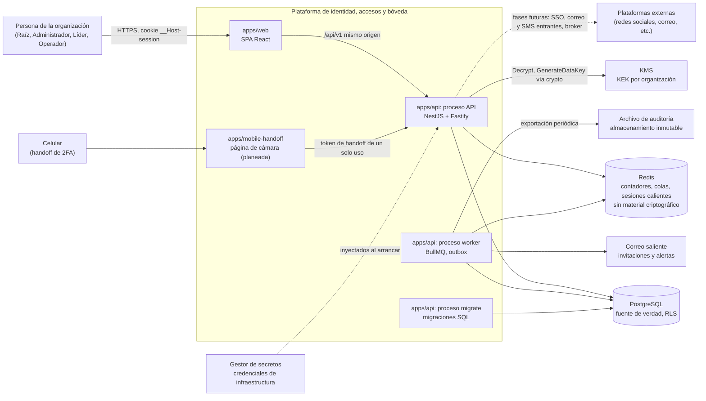
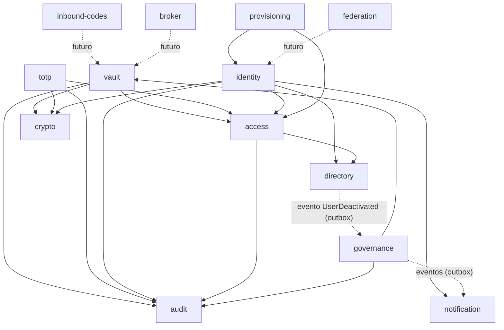
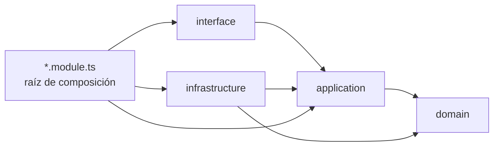
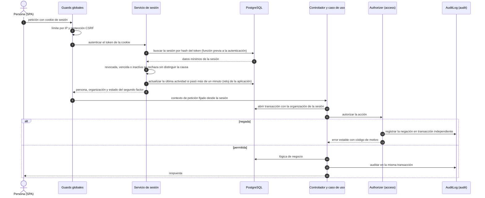
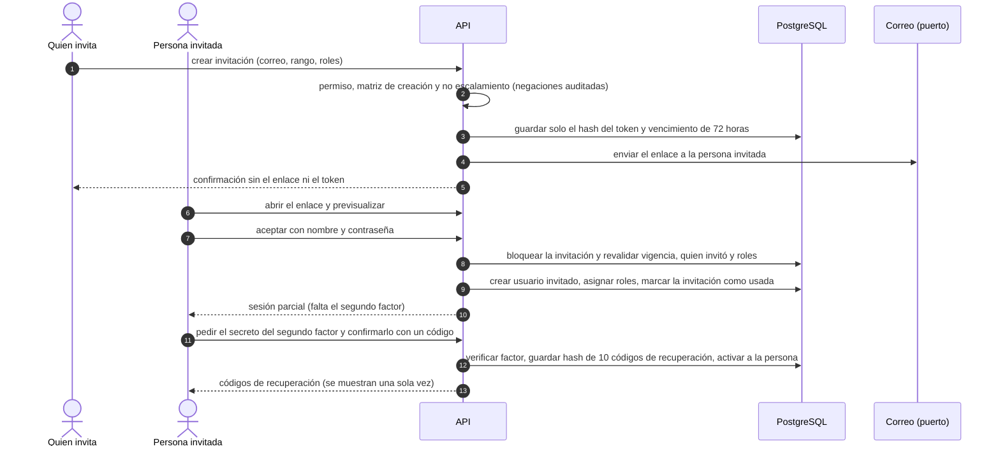

# Arquitectura

Visión de conjunto del sistema: monolito modular, procesos, módulos, capas, comunicación, aislamiento por organización y estructura del repositorio. La fuente de verdad es [`plan.md`](../plan.md) (sección "Arquitectura"); este documento la resume y no la reemplaza. Si algo aquí contradice al plan en seguridad, manda el plan. Las reglas de código detalladas están en [`backend.md`](backend.md) y [`frontend.md`](frontend.md).

Tipo de documento: explicación y referencia. Decisiones relacionadas: [ADR 0001](adr/0001-modular-monolith-hexagonal.md), [0002](adr/0002-nestjs-typescript-monorepo.md), [0006](adr/0006-multitenancy-ready-rls.md) y [0011](adr/0011-three-axis-authorization.md).

## Contenido

1. [Monolito modular y procesos](#1-monolito-modular-y-procesos)
2. [Contexto y contenedores](#2-contexto-y-contenedores)
3. [Módulos](#3-módulos)
4. [Capas hexagonales y regla de dependencia](#4-capas-hexagonales-y-regla-de-dependencia)
5. [Comunicación entre módulos](#5-comunicación-entre-módulos)
6. [Multitenancy en tres capas](#6-multitenancy-en-tres-capas)
7. [Estructura del repositorio](#7-estructura-del-repositorio)
8. [Flujo de un caso de uso sensible](#8-flujo-de-un-caso-de-uso-sensible)
9. [Flujos de la fase 1a: petición autenticada e invitación](#9-flujos-de-la-fase-1a-petición-autenticada-e-invitación)
10. [Estado actual (fases 0 y 1a)](#10-estado-actual-fases-0-y-1a)
11. [Decisiones pendientes](#11-decisiones-pendientes)

## 1. Monolito modular y procesos

Un repositorio, una imagen de contenedor y varios puntos de entrada en `apps/api` (`docs/backend.md` §8):

| Proceso | Entrada | Estado | Función |
| --- | --- | --- | --- |
| API | `main.http.ts` | Existe | Sirve `/api/v1` (REST) y, si se le indica la carpeta de la SPA compilada, el frontend en el mismo origen. SSE está planeado |
| Migraciones | `main.migrate.ts` | Existe | Aplica `db/migrations` con el rol de migraciones, como paso previo al despliegue |
| Alta de organizaciones | `main.provision.ts` | Existe | Comando de operaciones, con conexión de administración; nunca desde una petición HTTP (ver el [runbook](runbooks/provision-organization.md)) |
| Worker | `main.worker.ts` | Planeado, no existe | Procesará colas BullMQ y publicará el outbox (`outbox_events`); rotaciones, expiraciones, recifrado y purga de datos temporales |

El plan habla de "dos procesos (API y worker)" más las migraciones como paso previo de despliegue. La misma imagen sirve a todos con comandos de arranque distintos. Mientras no existan Redis ni el worker, el sistema debe operar con una sola instancia de la API ([runbook](runbooks/single-instance-operation.md)). Los módulos solo se hablan por fachadas públicas o eventos, lo que permite separar uno en su propio servicio más adelante sin reescribirlo.

## 2. Contexto y contenedores

Diagrama de contexto y contenedores. Los servicios externos se muestran con la referencia AWS del plan ([ADR 0020](adr/0020-reference-cloud-aws.md); lo que realmente se despliega es Dokploy, PostgreSQL dedicado y AWS solo para el KMS); cada uno está detrás de un puerto.



Notas:

- La web y la API se sirven desde el mismo origen: sin CORS abierto ni tokens en `localStorage` ([ADR 0014](adr/0014-server-sessions-with-cookie.md)).
- Solo `crypto` habla con el KMS y solo él importa primitivas criptográficas ([ADR 0004](adr/0004-server-side-encryption-kms-per-org-dek.md)).
- Redis nunca guarda material criptográfico ([ADR 0003](adr/0003-postgresql-single-source-of-truth.md)).

## 3. Módulos

El plan describe un diagrama de "12 módulos" y su tabla de responsabilidades enumera 13 entradas (10 de la fase 1 y 3 futuros). Esta tabla sigue la lista del plan. Los módulos futuros existen como carpetas con sus puertos y sin adaptadores.

| # | Módulo | Estado | Responsabilidad | Expone |
| --- | --- | --- | --- | --- |
| 1 | `organization` (kernel) | Fase 1 | Organizaciones, contexto de petición, configuración | `RequestContext`, configuración por organización |
| 2 | `identity` | Fase 1 (protegido). Implementado en 1a, con passkeys y códigos de emergencia de la Raíz | Invitaciones, contraseñas, passkeys, TOTP propio, sesiones, reautenticación | Autenticar, verificar sesión, exigir reautenticación |
| 3 | `directory` | Fase 1. Implementado en 1a (usuarios, jerarquía, directorio y gestión de personas; sin grupos) | Usuarios, rangos, responsable, grupos, membresías | Consultas de jerarquía y subárbol, eventos de baja |
| 4 | `access` | Fase 1 (protegido). Implementado en 1a (permisos, roles personalizados y motor de decisión; sin compartición) | Catálogo de permisos, roles, compartición, motor de decisión | `Authorizer.authorize()`, vista de acceso efectivo |
| 5 | `vault` | Fase 1 | Plataformas, cuentas, credenciales, versiones de secretos | Casos de uso de la bóveda |
| 6 | `totp` | Fase 1 | Registro (5 métodos), handoff, generación de códigos | Código actual de una credencial |
| 7 | `crypto` | Fase 0 y 1 (protegido) | `SecretCipher`, caché de DEK, rotación, índices ciegos | Cifrar, descifrar, HMAC por propósito |
| 8 | `audit` | Fase 0 y 1 (protegido) | Escritura encadenada, verificación, consulta, exportación | `AuditLog.record()` dentro de la transacción |
| 9 | `governance` | Fase 1 | Bajas con rotación, salud, acceso temporal | Tareas de rotación, paneles |
| 10 | `notification` | Fase 1. Implementado en 1a para invitaciones, el aviso de uso de un código de emergencia y los avisos de seguridad a la persona (código de recuperación usado, llave de acceso agregada o quitada), con adaptador SMTP del dominio propio (y uno de desarrollo) | Correos traducidos, SSE, alertas | Enviar, publicar evento al cliente |
| 11 | `federation` | Futuro (fases 2 y 3) | OIDC, SAML, SCIM | Por definir en esas fases |
| 12 | `inbound-codes` | Futuro (fases 4 y 5) | Ingesta de correos y SMS | Por definir en esas fases |
| 13 | `broker` | Futuro (fases 6 y 7) | Intenciones de login, sesiones delegadas | Por definir en esas fases |

La fase 1a añadió además `provisioning` (alta de organizaciones por operaciones, con una conexión de administración y nunca desde una petición HTTP) e `idempotency` (protección contra peticiones de creación repetidas, [ADR 0029](adr/0029-idempotency-reservation-and-ownership.md)), que el plan no lista como módulos propios. Se mantienen fuera de la tabla porque `provisioning` no atiende peticiones de las personas de la organización e `idempotency` es transversal.

Los módulos protegidos son `identity`, `access`, `crypto` y `audit` (más migraciones con RLS, `SecretReveal` y la configuración de CSP y cabeceras); cada uno lleva su propio `CLAUDE.md` y requiere dos revisores ([`CLAUDE.md`](../CLAUDE.md), "Rutas protegidas").

Dependencias entre módulos (flechas: "llama a la fachada de"). Las dependencias hacia `crypto`, `audit` y `access` son las que el plan nombra; el resto se deriva de las responsabilidades y puede ajustarse al implementar cada módulo.



Con la fase 1a, las flechas de `identity`, `access`, `directory` y `provisioning` reflejan el código implementado: `access` usa la regla de gestión de `directory` (no al revés, a diferencia de lo que dibujaba la versión anterior de este diagrama), e `identity` usa `access`, `directory` y `notification`. Línea continua: llamada síncrona a una fachada. Línea punteada: evento por outbox o dependencia futura. Todos los módulos pueden leer `RequestContext` de `organization` y los tipos de `shared/kernel`; esas aristas no se dibujan para no saturar el diagrama.

## 4. Capas hexagonales y regla de dependencia

Cada módulo se organiza en cuatro capas más una raíz de composición (`docs/backend.md` §3.2 y §3.3):

| Capa | Contiene | Puede importar |
| --- | --- | --- |
| `domain` | Entidades, objetos de valor, políticas, eventos de dominio, errores | Solo `domain` del módulo y `shared/kernel`. Sin NestJS, Drizzle ni Node |
| `application` | Casos de uso, puertos, DTO internos | `domain` del módulo, fachadas públicas de otros módulos y `shared/kernel` |
| `infrastructure` | Repositorios Drizzle, KMS, Redis, correo | `application`, `domain`, bibliotecas externas |
| `interface` | Controladores HTTP, SSE, procesadores de cola, mapeo a contratos | `application` del módulo y `packages/contracts` |
| `<modulo>.module.ts` | Raíz de composición: une puertos con adaptadores | Todas las capas del módulo |



La regla: las dependencias apuntan hacia `domain`; `domain` no importa nada del framework. Se verifica con `eslint-plugin-boundaries` y dependency-cruiser en CI, más una prueba de arquitectura. Además, `node:crypto` solo se importa en `modules/crypto`. Un caso de uso es una clase con un método `execute`, sin decoradores de Nest, que devuelve `Result<T, DomainError>`.

`*.module.ts` es una extensión que `docs/backend.md` §3.2 añade al plan, porque es el único sitio donde el cableado de DI puede conocer todas las capas sin romper la regla de dependencia.

## 5. Comunicación entre módulos

- **Síncrona**: un módulo llama a la fachada pública de otro (`index.ts`). Ejemplo: `vault` llama a `access.Authorizer` y a `crypto.SecretCipher`. La fachada exporta interfaces y casos de uso, nunca entidades ni repositorios.
- **Asíncrona**: eventos de dominio guardados en `outbox_events` **en la misma transacción** y publicados por el worker. Los consumidores son idempotentes. Ejemplo: `directory` emite `UserDeactivated` y `governance` crea las tareas de rotación.
- **Prohibido**: importar repositorios, entidades o tablas de otro módulo. Lo verifica el lint.

## 6. Multitenancy en tres capas

Una sola organización en producción, con aislamiento aplicado en tres capas ([ADR 0006](adr/0006-multitenancy-ready-rls.md)); si una falla, las otras dos contienen el error:

| Capa | Mecanismo | Garantía |
| --- | --- | --- |
| 1. Aplicación | `RequestContext` (AsyncLocalStorage) con `organizationId`, `actorId`, `requestId` y frescura de reautenticación; la organización sale de la sesión, nunca de un parámetro del cliente | Ningún caso de uso recibe `organizationId` como argumento libre |
| 2. Base de datos | Row-Level Security: `organization_id = current_setting('app.org_id')::uuid`; `UnitOfWork.run` ejecuta `SET LOCAL app.org_id`; rol de aplicación sin `BYPASSRLS` y no dueño de las tablas | Sin contexto, cero filas (falla cerrada) |
| 3. Criptografía | KEK y DEK por organización; el AAD incluye `org_id` | Texto cifrado de otra organización no se puede abrir con la DEK propia |

Las rutas previas a la autenticación (login, invitación, handoff, sesión) no conocen `app.org_id`; se resuelven con funciones de lectura mínimas y controladas, según el [ADR 0021](adr/0021-pre-authentication-access-with-rls.md) (aceptada e implementada en la fase 1a). El diseño de tablas y políticas está en [`database.md`](database.md).

## 7. Estructura del repositorio

Árbol observado en el repositorio al cierre de la fase 0 (los archivos de código fuente de `apps/api/src`, `apps/web/src` y los paquetes los crean otras tareas de la fase; ver [sección 10](#10-estado-actual-fases-0-y-1a)):

| Ruta | Contenido |
| --- | --- |
| `apps/api` | Backend (NestJS con Fastify). Tres puntos de entrada: API, worker y migraciones |
| `apps/web` | Aplicación web (React, Vite y Tailwind v4) |
| `packages/config` | Configuración base de TypeScript y ESLint, y reglas de límites entre capas |
| `packages/contracts` | Esquemas de validación, tipos y códigos de error compartidos |
| `packages/i18n` | Catálogos de textos `es-MX` y `en-US` |
| `packages/ui` | Tokens de diseño y componentes de interfaz |
| `db` | Migraciones versionadas con aislamiento por organización, y sus pruebas |
| `docs` | Guías, lógica de negocio, arquitectura, modelo de amenazas, ADR y runbooks |
| `odd/tasks` | Documentos de especificación y seguimiento por funcionalidad |
| `plan.md` | Fuente de verdad del producto |
| `CLAUDE.md` | Reglas no negociables para agentes |
| `package.json`, `pnpm-workspace.yaml`, `turbo.json` | Scripts raíz, espacios de trabajo (con espera de 7 días tras cada publicación y scripts de instalación en lista blanca) y tareas de Turborepo |
| `e2e` | Pruebas en navegador real (Playwright con el Chrome del sistema) y `pnpm stack`, que levanta la plataforma completa en local (PostgreSQL efímero, API y web en `localhost`) |
| `.github/workflows/ci.yml` | Verificación automática definida (formato, compilación, tipos, lint, pruebas y e2e); nunca se ha ejecutado en GitHub |
| Archivos de formato y de git en la raíz | Configuración de editor, Prettier, npm y exclusiones de git |

Planeado por el plan y aún no creado: `apps/mobile-handoff` (página ligera de cámara para el 2FA por celular), `CODEOWNERS`, la plantilla de PR y los `README.md` y `CLAUDE.md` por módulo.

Estructura de un módulo del backend (`apps/api/src/modules/<modulo>/`):

Cada módulo contiene una carpeta por capa (dominio, aplicación, infraestructura e interfaz), un archivo de composición que une puertos con adaptadores, una fachada pública que es el único punto de entrada para otros módulos, un `README.md` y, solo en módulos protegidos, un `CLAUDE.md`.

El detalle de la estructura está en `docs/backend.md` §3.3. El flujo de trabajo del equipo y los comandos están en el [`README.md`](../README.md) raíz.

## 8. Flujo de un caso de uso sensible

Obligatorio para todo caso de uso que toca usuarios o bóveda (`docs/backend.md` §5.2; motor de decisión de 7 pasos en `plan.md`, "Motor de decisión"). Ejemplo: `RevealPassword`.

```mermaid
sequenceDiagram
  autonumber
  actor U as Usuario (SPA)
  participant C as Controlador (interface)
  participant UC as Caso de uso (application)
  participant UoW as UnitOfWork
  participant Z as Authorizer (access)
  participant S as SecretCipher (crypto)
  participant A as AuditLog (audit)
  participant DB as PostgreSQL

  U->>C: POST /credentials/:id/reveal (cookie, motivo)
  C->>C: guard de sesión, CSRF y permiso (red de seguridad)
  C->>UC: execute(comando)
  UC->>UoW: run(...)
  UoW->>DB: BEGIN; SET LOCAL app.org_id
  UC->>Z: authorize(credential.reveal_password, recurso)
  Z-->>UC: Decision (permitido, motivo, obligaciones)
  alt negado
    UC-->>C: Result.err (código estable)
    Note over UC,A: la negación también se audita, en transacción independiente; ver ADR 0022 (aceptada)
  else permitido
    UC->>S: descifrar con propósito REVEAL (AAD org_id, credential_id, field, version)
    S-->>UC: secreto en memoria
    UC->>A: record(evento) en la misma transacción
    UC->>DB: outbox_events (misma transacción)
    UoW->>DB: COMMIT
    UC-->>C: Result.ok
    C-->>U: 200 con Cache-Control: no-store
  end
```

Reglas que el flujo hace cumplir:

1. Se abre la transacción con contexto de organización antes de cualquier consulta.
2. `Authorizer.authorize()` evalúa organización, sesión, permiso, jerarquía, compartición y restricciones de contexto (reautenticación vigente, motivo escrito); el guard del controlador no es la autorización.
3. La auditoría se escribe en la misma transacción; si falla, la acción falla (falla cerrada, [ADR 0016](adr/0016-append-only-audit-hash-chain.md)).
4. El secreto solo viaja en la respuesta dedicada, con `Cache-Control: no-store`, y nunca se registra en logs.
5. Los eventos de dominio van al outbox en la misma transacción y los publica el worker.

Las negaciones se registran en una transacción independiente ([ADR 0022](adr/0022-audit-of-denials-in-independent-transaction.md), aceptada e implementada en la fase 1a). El advisory lock de auditoría con transacciones largas se aceptó el 2026-10-27 ([ADR 0023](adr/0023-audit-advisory-lock-and-long-transactions.md)); su `lock_timeout` aún no está implementado.

## 9. Flujos de la fase 1a: petición autenticada e invitación

### 9.1 Petición autenticada

Toda ruta exige una sesión válida salvo las marcadas como públicas. Las rutas de sesión parcial aceptan una sesión que todavía no completó el segundo factor.



### 9.2 Invitación y alta de una persona



El detalle paso a paso está en [`backend.md`](backend.md) §3.7 y §3.8. En producción el correo sale por el SMTP del dominio propio ([runbook](runbooks/configure-mail.md)); en desarrollo, el adaptador de desarrollo escribe el enlace en el registro. El alta inicial registra la aplicación autenticadora; las passkeys se agregan después desde la pantalla de seguridad.

## 10. Estado actual (fases 0 y 1a)

La **fase 0** está terminada y entregó el esqueleto: monorepo, contexto de organización, `crypto` y `audit` con pruebas, RLS activo, esqueleto de UI con tokens oscuros e i18n, y los ADR 0001 a 0020. El criterio de salida completo está en `plan.md` ("Criterios de salida por fase") y el seguimiento en [`odd/tasks/phase-0-foundations.md`](../odd/tasks/phase-0-foundations.md).

La **fase 1a (identidad)** está implementada en lo esencial en backend y frontend: alta de organización por operaciones con códigos de emergencia de la Raíz, invitaciones reenviables por el correo del dominio propio, contraseña y segundo factor con aplicación autenticadora o passkey, cambio obligatorio de la contraseña inicial, inicio de sesión, sesiones propias y ajenas, reautenticación, motor de autorización con 27 permisos y auditoría de negaciones, roles personalizados, gestión de personas, idempotencia de las creaciones y directorio. La web ofrece las pantallas correspondientes (ver [`frontend.md`](frontend.md) §18). Las pruebas de punta a punta pasan contra PostgreSQL real y en Chrome real. No está cerrada: faltan, entre otros, Redis, la purga de datos temporales y la recuperación de la Raíz sin contraseña ni factores (§11). La **fase 1b (bóveda y segundo factor) no ha empezado**; su plan está en [`odd/tasks/phase-1b-vault.md`](../odd/tasks/phase-1b-vault.md). La lógica de negocio está en [`business/`](business/README.md) y el estado detallado en [`business/roadmap-and-status.md`](business/roadmap-and-status.md).

## 11. Decisiones pendientes

Vigentes tras la fase 1a. El detalle técnico está en [`backend.md`](backend.md) §16.

| Tema | Situación |
| --- | --- |
| Passkeys (WebAuthn) | **Resuelta** ([ADR 0028](adr/0028-passkeys-optional-enforcement-later.md)): opcionales para todos. Sigue abierta la configuración para exigirlas a la Raíz y a los Administradores |
| Cambio de la contraseña inicial de la Raíz | **Resuelto**: obligatorio en el primer ingreso |
| Redis para límites de intentos y por IP | Pendiente. Hoy en memoria de cada instancia; el sistema debe operar con una sola instancia hasta incorporarlo ([runbook](runbooks/single-instance-operation.md)) |
| Proveedor de correo | **Resuelto** para invitaciones y el aviso de códigos de emergencia: SMTP del dominio propio. Faltan los avisos de dispositivo nuevo, baja del factor de aplicación y regeneración de códigos |
| Idempotencia de peticiones que crean recursos | **Resuelta** ([ADR 0029](adr/0029-idempotency-reservation-and-ownership.md)); falta la purga de filas vencidas |
| Recuperación de la Raíz que olvida su contraseña y pierde sus factores | Sin solución en el sistema; falta un procedimiento de operaciones |
| Purga de datos temporales vencidos (idempotencia, desafíos de passkeys) | Pendiente; necesita un camino para recorrer organizaciones ([`database.md`](database.md) §7.5) |
| Auditoría de negaciones | **Resuelta** ([ADR 0022](adr/0022-audit-of-denials-in-independent-transaction.md)); sigue abierta la agrupación de negaciones repetidas |
| Advisory lock de auditoría en transacciones largas | Aceptada, `lock_timeout` pendiente ([ADR 0023](adr/0023-audit-advisory-lock-and-long-transactions.md)) |
| Retención de auditoría | Propuesta ([ADR 0024](adr/0024-audit-retention-vs-revoke-delete.md)) |
