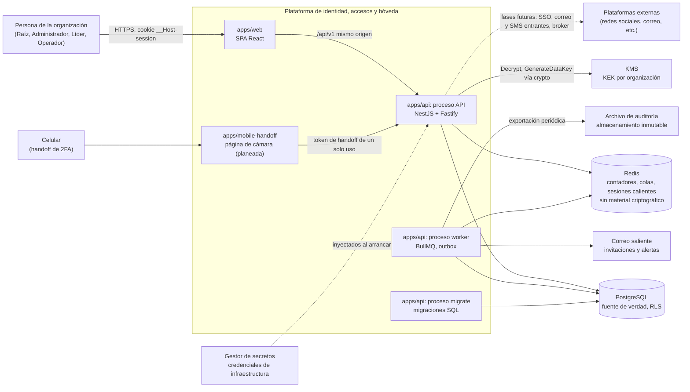
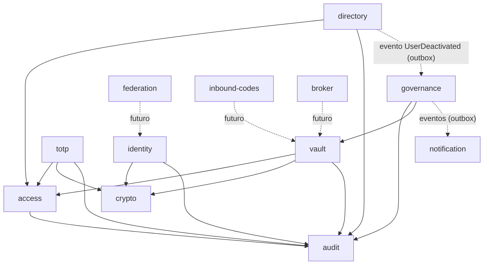
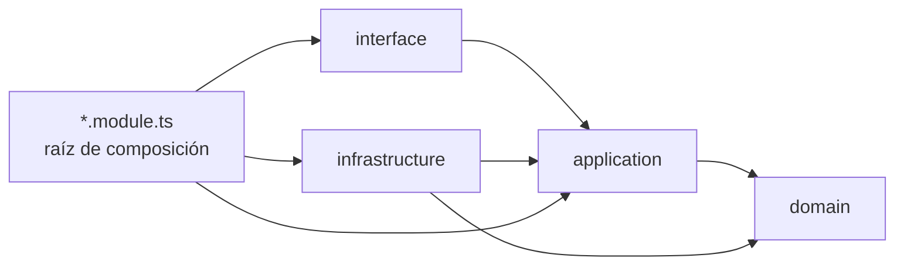

# Arquitectura

Visión de conjunto del sistema: monolito modular, procesos, módulos, capas, comunicación, aislamiento por organización y estructura del repositorio. La fuente de verdad es [`plan.md`](../plan.md) (sección "Arquitectura"); este documento la resume y no la reemplaza. Si algo aquí contradice al plan en seguridad, manda el plan. Las reglas de código detalladas están en [`backend.md`](backend.md) y [`frontend.md`](frontend.md).

Tipo de documento: explicación y referencia. Decisiones relacionadas: [ADR 0001](adr/0001-modular-monolith-hexagonal.md), [0002](adr/0002-nestjs-typescript-monorepo.md), [0006](adr/0006-multitenancy-ready-rls.md) y [0011](adr/0011-three-axis-authorization.md).

## Contenido

1. [Monolito modular y procesos](#1-monolito-modular-y-procesos)
2. [Contexto y contenedores](#2-contexto-y-contenedores)
3. [Módulos](#3-módulos)
4. [Capas hexagonales y regla de dependencia](#4-capas-hexagonales-y-regla-de-dependencia)
5. [Comunicación entre módulos](#5-comunicación-entre-módulos)
6. [Multitenancy en tres capas](#6-multitenancy-en-tres-capas)
7. [Estructura del repositorio](#7-estructura-del-repositorio)
8. [Flujo de un caso de uso sensible](#8-flujo-de-un-caso-de-uso-sensible)
9. [Estado actual (fase 0)](#9-estado-actual-fase-0)

## 1. Monolito modular y procesos

Un repositorio, una imagen de contenedor y tres puntos de entrada en `apps/api` (`docs/backend.md` §8):

| Proceso | Entrada | Función |
| --- | --- | --- |
| API | `main.http.ts` | Sirve `/api/v1` (REST y SSE) y, en producción, la SPA en el mismo origen |
| Worker | `main.worker.ts` | Procesa colas BullMQ y publica el outbox (`outbox_events`); rotaciones, expiraciones, recifrado y correos |
| Migraciones | `main.migrate.ts` | Aplica `db/migrations` con el rol de migraciones, como paso previo al despliegue |

El plan habla de "dos procesos (API y worker)" más las migraciones como paso previo de despliegue. La misma imagen sirve a los tres con comandos de arranque distintos. Los módulos solo se hablan por fachadas públicas o eventos, lo que permite separar uno en su propio servicio más adelante sin reescribirlo.

## 2. Contexto y contenedores

Diagrama de contexto y contenedores. Los servicios externos se muestran con la referencia AWS del plan ([ADR 0020](adr/0020-reference-cloud-aws.md), confirmación pendiente); cada uno está detrás de un puerto.



Notas:

- La web y la API se sirven desde el mismo origen: sin CORS abierto ni tokens en `localStorage` ([ADR 0014](adr/0014-server-sessions-with-cookie.md)).
- Solo `crypto` habla con el KMS y solo él importa primitivas criptográficas ([ADR 0004](adr/0004-server-side-encryption-kms-per-org-dek.md)).
- Redis nunca guarda material criptográfico ([ADR 0003](adr/0003-postgresql-single-source-of-truth.md)).

## 3. Módulos

El plan describe un diagrama de "12 módulos" y su tabla de responsabilidades enumera 13 entradas (10 de la fase 1 y 3 futuros). Esta tabla sigue la lista del plan. Los módulos futuros existen como carpetas con sus puertos y sin adaptadores.

| # | Módulo | Estado | Responsabilidad | Expone |
| --- | --- | --- | --- | --- |
| 1 | `organization` (kernel) | Fase 1 | Organizaciones, contexto de petición, configuración | `RequestContext`, configuración por organización |
| 2 | `identity` | Fase 1 (protegido) | Invitaciones, contraseñas, passkeys, TOTP propio, sesiones, reautenticación | Autenticar, verificar sesión, exigir reautenticación |
| 3 | `directory` | Fase 1 | Usuarios, rangos, responsable, grupos, membresías | Consultas de jerarquía y subárbol, eventos de baja |
| 4 | `access` | Fase 1 (protegido) | Catálogo de permisos, roles, compartición, motor de decisión | `Authorizer.authorize()`, vista de acceso efectivo |
| 5 | `vault` | Fase 1 | Plataformas, cuentas, credenciales, versiones de secretos | Casos de uso de la bóveda |
| 6 | `totp` | Fase 1 | Registro (5 métodos), handoff, generación de códigos | Código actual de una credencial |
| 7 | `crypto` | Fase 0 y 1 (protegido) | `SecretCipher`, caché de DEK, rotación, índices ciegos | Cifrar, descifrar, HMAC por propósito |
| 8 | `audit` | Fase 0 y 1 (protegido) | Escritura encadenada, verificación, consulta, exportación | `AuditLog.record()` dentro de la transacción |
| 9 | `governance` | Fase 1 | Bajas con rotación, salud, acceso temporal | Tareas de rotación, paneles |
| 10 | `notification` | Fase 1 | Correos traducidos, SSE, alertas | Enviar, publicar evento al cliente |
| 11 | `federation` | Futuro (fases 2 y 3) | OIDC, SAML, SCIM | Por definir en esas fases |
| 12 | `inbound-codes` | Futuro (fases 4 y 5) | Ingesta de correos y SMS | Por definir en esas fases |
| 13 | `broker` | Futuro (fases 6 y 7) | Intenciones de login, sesiones delegadas | Por definir en esas fases |

Los módulos protegidos son `identity`, `access`, `crypto` y `audit` (más migraciones con RLS, `SecretReveal` y la configuración de CSP y cabeceras); cada uno lleva su propio `CLAUDE.md` y requiere dos revisores ([`CLAUDE.md`](../CLAUDE.md), "Rutas protegidas").

Dependencias entre módulos (flechas: "llama a la fachada de"). Las dependencias hacia `crypto`, `audit` y `access` son las que el plan nombra; el resto se deriva de las responsabilidades y puede ajustarse al implementar cada módulo.



Línea continua: llamada síncrona a una fachada. Línea punteada: evento por outbox o dependencia futura. Todos los módulos pueden leer `RequestContext` de `organization` y los tipos de `shared/kernel`; esas aristas no se dibujan para no saturar el diagrama.

## 4. Capas hexagonales y regla de dependencia

Cada módulo se organiza en cuatro capas más una raíz de composición (`docs/backend.md` §3.2 y §3.3):

| Capa | Contiene | Puede importar |
| --- | --- | --- |
| `domain` | Entidades, objetos de valor, políticas, eventos de dominio, errores | Solo `domain` del módulo y `shared/kernel`. Sin NestJS, Drizzle ni Node |
| `application` | Casos de uso, puertos, DTO internos | `domain` del módulo, fachadas públicas de otros módulos y `shared/kernel` |
| `infrastructure` | Repositorios Drizzle, KMS, Redis, correo | `application`, `domain`, bibliotecas externas |
| `interface` | Controladores HTTP, SSE, procesadores de cola, mapeo a contratos | `application` del módulo y `packages/contracts` |
| `<modulo>.module.ts` | Raíz de composición: une puertos con adaptadores | Todas las capas del módulo |



La regla: las dependencias apuntan hacia `domain`; `domain` no importa nada del framework. Se verifica con `eslint-plugin-boundaries` y dependency-cruiser en CI, más una prueba de arquitectura. Además, `node:crypto` solo se importa en `modules/crypto`. Un caso de uso es una clase con un método `execute`, sin decoradores de Nest, que devuelve `Result<T, DomainError>`.

`*.module.ts` es una extensión que `docs/backend.md` §3.2 añade al plan, porque es el único sitio donde el cableado de DI puede conocer todas las capas sin romper la regla de dependencia.

## 5. Comunicación entre módulos

- **Síncrona**: un módulo llama a la fachada pública de otro (`index.ts`). Ejemplo: `vault` llama a `access.Authorizer` y a `crypto.SecretCipher`. La fachada exporta interfaces y casos de uso, nunca entidades ni repositorios.
- **Asíncrona**: eventos de dominio guardados en `outbox_events` **en la misma transacción** y publicados por el worker. Los consumidores son idempotentes. Ejemplo: `directory` emite `UserDeactivated` y `governance` crea las tareas de rotación.
- **Prohibido**: importar repositorios, entidades o tablas de otro módulo. Lo verifica el lint.

## 6. Multitenancy en tres capas

Una sola organización en producción, con aislamiento aplicado en tres capas ([ADR 0006](adr/0006-multitenancy-ready-rls.md)); si una falla, las otras dos contienen el error:

| Capa | Mecanismo | Garantía |
| --- | --- | --- |
| 1. Aplicación | `RequestContext` (AsyncLocalStorage) con `organizationId`, `actorId`, `requestId` y frescura de reautenticación; la organización sale de la sesión, nunca de un parámetro del cliente | Ningún caso de uso recibe `organizationId` como argumento libre |
| 2. Base de datos | Row-Level Security: `organization_id = current_setting('app.org_id')::uuid`; `UnitOfWork.run` ejecuta `SET LOCAL app.org_id`; rol de aplicación sin `BYPASSRLS` y no dueño de las tablas | Sin contexto, cero filas (falla cerrada) |
| 3. Criptografía | KEK y DEK por organización; el AAD incluye `org_id` | Texto cifrado de otra organización no se puede abrir con la DEK propia |

Pendiente de decisión: las rutas previas a la autenticación (login, invitación, handoff, sesión) no conocen `app.org_id`; ver [ADR 0021](adr/0021-pre-authentication-access-with-rls.md) (Propuesta). El diseño de tablas y políticas está en [`database.md`](database.md).

## 7. Estructura del repositorio

Árbol observado en el repositorio al cierre de la fase 0 (los archivos de código fuente de `apps/api/src`, `apps/web/src` y los paquetes los crean otras tareas de la fase; ver [sección 9](#9-estado-actual-fase-0)):

```
/
├─ apps/
│  ├─ api/                 # @iam/api: NestJS (Fastify); main.http.ts, main.worker.ts, main.migrate.ts
│  └─ web/                 # @iam/web: SPA React + Vite + Tailwind v4
├─ packages/
│  ├─ config/              # @iam/config: tsconfig base y react, ESLint base y reglas de límites
│  ├─ contracts/           # @iam/contracts: esquemas Zod, tipos, códigos de error
│  ├─ i18n/                # @iam/i18n: catálogos es-MX y en-US
│  └─ ui/                  # @iam/ui: tokens de diseño y componentes
├─ db/                     # @iam/db: migraciones SQL versionadas con RLS y pruebas de aislamiento
├─ docs/                   # guías, architecture.md, threat-model.md, adr/, runbooks/
├─ odd/
│  └─ tasks/               # documentos de especificación y seguimiento por funcionalidad
├─ plan.md                 # fuente de verdad del producto
├─ CLAUDE.md               # reglas no negociables para agentes
├─ package.json            # scripts raíz (Turborepo) y engines
├─ pnpm-workspace.yaml     # apps/*, packages/*, db; minimumReleaseAge, scripts de instalación en lista blanca
├─ turbo.json              # tareas build, typecheck, lint, test, dev
└─ .npmrc, .editorconfig, .prettierrc.json, .prettierignore, .gitignore
```

Planeado por el plan y aún no creado: `apps/mobile-handoff` (página ligera de cámara para el 2FA por celular), `CODEOWNERS`, la plantilla de PR y los `README.md` y `CLAUDE.md` por módulo.

Estructura de un módulo del backend (`apps/api/src/modules/<modulo>/`):

```
domain/            # entidades, políticas, errores (TS puro)
application/       # casos de uso y puertos
infrastructure/    # repositorios Drizzle, adaptadores
interface/         # controladores, mapeo a contratos
<modulo>.module.ts # raíz de composición
index.ts           # fachada pública del módulo
README.md
CLAUDE.md          # solo en módulos protegidos
```

El detalle de archivos de ejemplo está en `docs/backend.md` §3.3. El flujo de trabajo del equipo y los comandos están en el [`README.md`](../README.md) raíz.

## 8. Flujo de un caso de uso sensible

Obligatorio para todo caso de uso que toca usuarios o bóveda (`docs/backend.md` §5.2; motor de decisión de 7 pasos en `plan.md`, "Motor de decisión"). Ejemplo: `RevealPassword`.

```mermaid
sequenceDiagram
  autonumber
  actor U as Usuario (SPA)
  participant C as Controlador (interface)
  participant UC as Caso de uso (application)
  participant UoW as UnitOfWork
  participant Z as Authorizer (access)
  participant S as SecretCipher (crypto)
  participant A as AuditLog (audit)
  participant DB as PostgreSQL

  U->>C: POST /credentials/:id/reveal (cookie, motivo)
  C->>C: guard de sesión, CSRF y permiso (red de seguridad)
  C->>UC: execute(comando)
  UC->>UoW: run(...)
  UoW->>DB: BEGIN; SET LOCAL app.org_id
  UC->>Z: authorize(credential.reveal_password, recurso)
  Z-->>UC: Decision (permitido, motivo, obligaciones)
  alt negado
    UC-->>C: Result.err (código estable)
    Note over UC,A: la negación también se audita; ver ADR 0022 (Propuesta)
  else permitido
    UC->>S: descifrar con propósito REVEAL (AAD org_id, credential_id, field, version)
    S-->>UC: secreto en memoria
    UC->>A: record(evento) en la misma transacción
    UC->>DB: outbox_events (misma transacción)
    UoW->>DB: COMMIT
    UC-->>C: Result.ok
    C-->>U: 200 con Cache-Control: no-store
  end
```

Reglas que el flujo hace cumplir:

1. Se abre la transacción con contexto de organización antes de cualquier consulta.
2. `Authorizer.authorize()` evalúa organización, sesión, permiso, jerarquía, compartición y restricciones de contexto (reautenticación vigente, motivo escrito); el guard del controlador no es la autorización.
3. La auditoría se escribe en la misma transacción; si falla, la acción falla (falla cerrada, [ADR 0016](adr/0016-append-only-audit-hash-chain.md)).
4. El secreto solo viaja en la respuesta dedicada, con `Cache-Control: no-store`, y nunca se registra en logs.
5. Los eventos de dominio van al outbox en la misma transacción y los publica el worker.

Puntos abiertos que afectan este flujo y están en estado Propuesta: negaciones en transacción independiente ([ADR 0022](adr/0022-audit-of-denials-in-independent-transaction.md)) y el advisory lock de auditoría con transacciones largas ([ADR 0023](adr/0023-audit-advisory-lock-and-long-transactions.md)).

## 9. Estado actual (fase 0)

La fase 0 entrega el esqueleto: monorepo, contexto de organización, `crypto` y `audit` con pruebas, RLS activo, esqueleto de UI con tokens oscuros e i18n, y los ADR 0001 a 0020. El criterio de salida completo está en `plan.md` ("Criterios de salida por fase") y el seguimiento en [`odd/tasks/phase-0-foundations.md`](../odd/tasks/phase-0-foundations.md). Los módulos de negocio de la fase 1 aún no existen.
