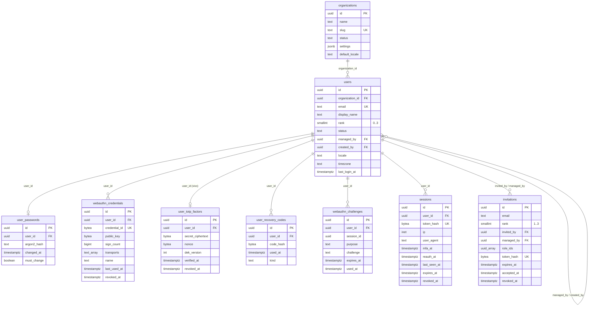
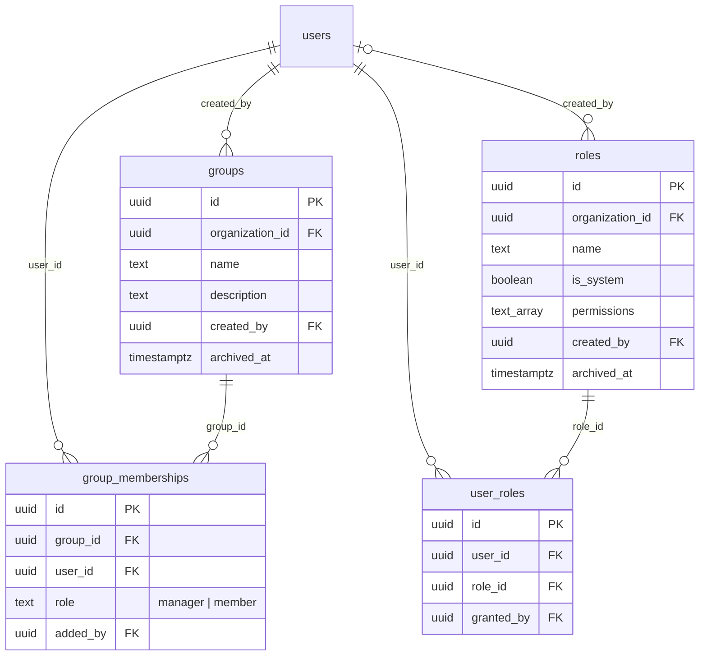
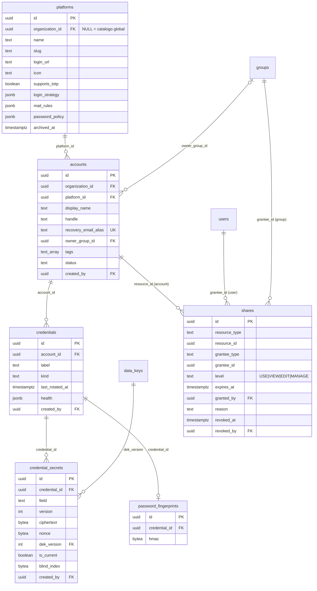
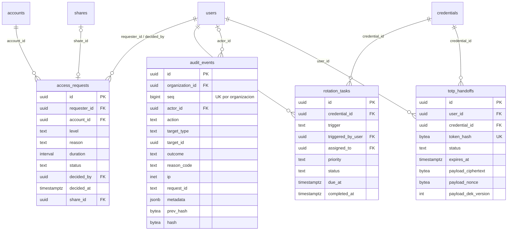
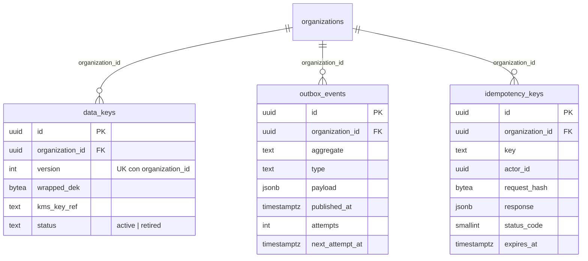
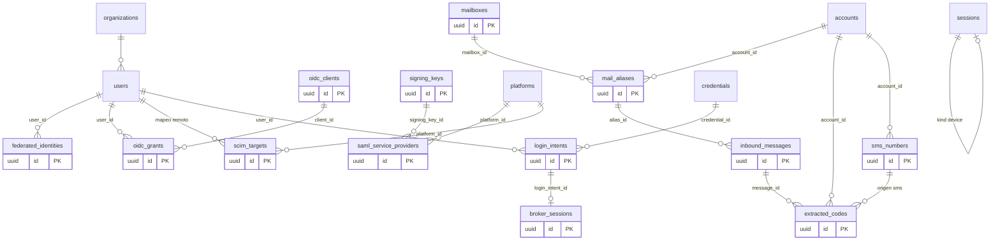

# Base de datos

Diseño de la base de datos de la plataforma (PostgreSQL 18). Este documento describe lo que **ya existe** en `db/migrations` (fase 1) y cómo quedará la base al terminar las fases 2 a 7. La fuente de verdad del modelo es `plan.md` ("Modelo de dominio y de datos"); si algo contradice al plan en seguridad, manda el plan.

## 1. Visión general

- PostgreSQL es la única fuente de verdad (ADR 003). Un solo esquema de dominio (`public`) y un esquema mínimo `auth` para el acceso previo a la autenticación.
- Aislamiento por organización en tres capas (ADR 006): contexto de petición, **RLS** en la base y claves de cifrado por organización. Este documento cubre la segunda; la tercera está en el plan ("Diseño criptográfico").
- Las migraciones son SQL plano versionado (`db/migrations/NNNN_nombre.sql`), aplicadas por `db/src/migrate.ts` con el rol `iam_migrator`. Nunca se edita una migración aplicada: el ejecutor guarda el SHA-256 de cada archivo en `schema_migrations` y **rechaza** ejecutar si cambia.
- Sin extensiones: los UUIDv7 los genera una función propia de la base de datos (PostgreSQL 18 ya trae `uuidv7()` nativo, pero las migraciones ya aplicadas usan la función propia y no se editan) y los hashes usan el SHA-256 del núcleo. Menos extensiones, menos privilegios que pedir al proveedor gestionado.

### Migraciones existentes

| Archivo                             | Contenido                                                                                                                                                                           |
| ----------------------------------- | ----------------------------------------------------------------------------------------------------------------------------------------------------------------------------------- |
| `0001_base_roles_functions.sql`     | Verifica los roles; crea el esquema `auth`, la función generadora de UUIDv7 y el trigger que actualiza la fecha de modificación                                                     |
| `0002_organizations_identity.sql`   | `organizations`, `users`, `user_passwords`, `webauthn_credentials`, `user_totp_factors`, `user_recovery_codes`, `sessions`, `invitations`                                           |
| `0003_crypto_infra.sql`             | `data_keys`, `outbox_events`, `idempotency_keys`                                                                                                                                    |
| `0004_directory_access.sql`         | `groups`, `group_memberships`, `roles`, `user_roles`                                                                                                                                |
| `0005_vault.sql`                    | `platforms` (con catálogo global sembrado), `accounts`, `credentials`, `credential_secrets`, `shares`, `password_fingerprints`                                                      |
| `0006_governance_audit.sql`         | `access_requests`, `rotation_tasks`, `totp_handoffs`, `audit_events` (cadena de hashes)                                                                                             |
| `0007_effective_access_view.sql`    | Vista `effective_access`                                                                                                                                                            |
| `0008_auth_functions.sql`           | Funciones `auth.*` (`SECURITY DEFINER`)                                                                                                                                             |
| `0009_totp_replay_protection.sql`   | Columna `last_used_step` en `user_totp_factors`: un código TOTP solo se acepta si su paso es mayor al último aceptado                                                               |
| `0010_emergency_codes.sql`          | Columna `kind` (`recovery` por defecto, o `emergency`) en `user_recovery_codes`, para los códigos de emergencia de la Raíz                                                          |
| `0011_webauthn_challenges.sql`      | Tabla `webauthn_challenges` (desafíos de las ceremonias de passkey) con aislamiento por fila                                                                                        |
| `0017_audit_actor_action_index.sql` | Índice `(organization_id, actor_id, action, created_at desc)` en `audit_events`, para contar los eventos de una persona en una ventana de tiempo (límite de revelaciones, ADR 0031) |
| `0019_outbox_deliveries.sql`        | Tabla `outbox_deliveries` (acuses de entrega de los manejadores del outbox, con aislamiento por fila y sin clave foránea hacia `outbox_events`; ver ADR 0035)                       |

### Cómo se ejecuta

El CLI de `db/src/cli.ts` ofrece dos operaciones, ambas con la dirección de la base de datos en la variable de entorno `DATABASE_URL`:

| Operación                    | Quién la ejecuta                          | Cuándo                                       |
| ---------------------------- | ----------------------------------------- | -------------------------------------------- |
| Preparar roles (`bootstrap`) | Una conexión de administrador del clúster | Una sola vez por clúster                     |
| Migrar (`migrate`)           | El rol de migraciones                     | En cada despliegue, antes de arrancar la API |

El ejecutor aplica cada archivo en su propia transacción junto con su registro en la tabla de control de migraciones, serializa ejecuciones concurrentes con un bloqueo consultivo y rechaza tres situaciones: huella (SHA-256) distinta de un archivo ya aplicado, archivo aplicado que desapareció y archivo nuevo numerado antes del último aplicado. Patrón _expandir y contraer_: se agrega, se despliega código compatible, y se retira lo viejo en otra migración.

Los **respaldos de datos** dentro de una migración deben recordar que el aislamiento forzado por organización aplica también al dueño de las tablas. Hay dos caminos: recorrer una organización a la vez fijando su contexto solo para esa transacción, o desactivar el aislamiento forzado de la tabla y restablecerlo **dentro de la misma transacción** (así siembra la migración 0005 el catálogo global).

## 2. Convenciones

| Convención               | Detalle                                                                                                                                                                                                                                                                   |
| ------------------------ | ------------------------------------------------------------------------------------------------------------------------------------------------------------------------------------------------------------------------------------------------------------------------- |
| Identificadores          | `id` es la clave primaria, un UUIDv7 generado por defecto: ordenable por tiempo, buena localidad en índices, no expone conteos                                                                                                                                            |
| Tenant                   | `organization_id uuid not null references organizations(id)` en toda tabla de dominio (salvo `organizations` y las filas globales de `platforms`)                                                                                                                         |
| Tiempo                   | `timestamptz` siempre (UTC). `created_at` y `updated_at`; un trigger mantiene `updated_at` en las tablas editables                                                                                                                                                        |
| Bajas lógicas            | `status` o `archived_at` / `revoked_at`. Nada del dominio se borra físicamente (ver excepciones abajo)                                                                                                                                                                    |
| Concurrencia optimista   | `version integer not null default 1` en agregados editables. Lo incrementa el repositorio al guardar, solo si la versión sigue siendo la esperada (la misma que el cliente envía en la cabecera de condición de la petición), y no un trigger, para no doblar incrementos |
| Nombres                  | Inglés, `snake_case`                                                                                                                                                                                                                                                      |
| Integridad entre tenants | Claves foráneas **compuestas** `(organization_id, x_id) -> tabla(organization_id, id)`. Las comprobaciones de FK ignoran RLS, así que esta es la única defensa contra referencias entre organizaciones                                                                    |
| Índices                  | Todo índice compuesto empieza por `organization_id`. Una prueba de CI lo verifica para toda tabla descubierta dinámicamente                                                                                                                                               |
| Secretos                 | Cifrados con AES-256-GCM: `ciphertext` (incluye el tag de 16 bytes), `nonce` de 12 bytes, `dek_version`. Tokens y claves de un solo uso: solo su SHA-256 (`bytea`, 32 bytes)                                                                                              |
| Estados                  | Texto con una restricción que lista los valores permitidos. Se prefiere a `enum` porque agregar un valor es una migración trivial y reversible                                                                                                                            |

**Excepciones a "nada se borra"** (el rol de la aplicación tiene `DELETE` solo ahí):

- Datos efímeros con TTL: `sessions`, `invitations`, `totp_handoffs`, `idempotency_keys`, `webauthn_challenges`, `outbox_events` (publicados).
- Filas de relación cuya historia vive en la auditoría: `group_memberships`, `user_roles`.
- Versiones antiguas de secretos (`credential_secrets` con `is_current = false`), que un job destruye a los 30 días. Una política RLS de `DELETE` impide borrar la versión vigente.

`users`, `groups`, `roles`, `accounts`, `credentials`, `shares`, `audit_events` y `data_keys` no admiten `DELETE` para `iam_app`.

## 3. Roles de base de datos

Los roles son del clúster, no de la base, por eso **no** los crea una migración (el migrador no tiene `CREATEROLE`): los provisiona una vez `bootstrapRoles()` (`db/src/bootstrap.ts`) con una conexión de administrador, y `0001` solo verifica que existan. Se crean `NOLOGIN`: operaciones asigna `LOGIN` y contraseña desde el gestor de secretos; ninguna credencial vive en el repositorio.

| Rol               | Es                                            | Puede                                                                                 | No puede                                                                                                                                           |
| ----------------- | --------------------------------------------- | ------------------------------------------------------------------------------------- | -------------------------------------------------------------------------------------------------------------------------------------------------- |
| `iam_migrator`    | Dueño de todas las tablas, vistas y funciones | DDL, sembrar el catálogo global                                                       | Reescribir `audit_events` (se revocó `UPDATE`/`DELETE`/`TRUNCATE` incluso al dueño). Con `FORCE RLS` tampoco lee datos de tenants sin `app.org_id` |
| `iam_app`         | Rol de la API y los workers                   | `SELECT/INSERT/UPDATE` (y `DELETE` en las excepciones) con RLS; `EXECUTE` en `auth.*` | `BYPASSRLS`, ser dueño, DDL, `UPDATE/DELETE` en `audit_events`, modificar el catálogo global, reescribir `ciphertext` o `wrapped_dek`              |
| `iam_auth_reader` | Dueño de las funciones `auth.*`               | `SELECT` por columnas, solo a través de esas funciones                                | Login, `BYPASSRLS`, leer otras columnas                                                                                                            |

Además: `revoke create on schema public from public` y `revoke temporary on database ... from public`. Los grants son por tabla y explícitos; los `UPDATE` de `credential_secrets` y `data_keys` son **por columna** (`is_current` y `status`), de modo que el texto cifrado y el material de claves son inmutables para la aplicación.

Una prueba (`db/tests/migrations.test.ts`) verifica que `iam_app` no sea superusuario ni tenga `BYPASSRLS`, y que `iam_migrator` sea el único dueño de las tablas.

## 4. Diagramas entidad-relación

En todas las relaciones de dominio la clave foránea es compuesta `(organization_id, ...)`; los diagramas la abrevian a la columna de negocio. Se omiten `created_at`, `updated_at` y `version`.

### 4.1 Identidad

### 4.2 Directorio y acceso

### 4.3 Bóveda

### 4.4 Gobernanza y auditoría

### 4.5 Criptografía e infraestructura

## 5. Catálogo de tablas (fase 1)

Notación: **PK** clave primaria (`id`), **UK** único, **FK(c)** clave foránea compuesta con `organization_id`. Todas las tablas (salvo `organizations`) tienen además `organization_id uuid not null`, `id uuid` (UUIDv7) y `created_at timestamptz not null default now()`; las editables, `updated_at` y, donde se indica, `version`. Las columnas `created_at`/`updated_at`/`version` no se repiten abajo.

Las columnas del plan ("Tablas de la fase 1") están todas. Las columnas **adicionales** que el propio plan exige en otros apartados se marcan con `+`.

### 5.1 Organización e identidad

**`organizations`** (sin `organization_id`; la fila es el tenant). `version`.

| Columna        | Tipo  | Restricciones                                 |
| -------------- | ----- | --------------------------------------------- |
| name           | text  | not null, 1 a 200 caracteres                  |
| slug           | text  | not null, **UK**, `^[a-z0-9][a-z0-9-]{1,62}$` |
| status         | text  | `active` \| `suspended`, default `active`     |
| settings       | jsonb | not null, objeto, default `{}`                |
| default_locale | text  | `es-MX` \| `en-US`, default `es-MX`           |

**`users`** `version`. Índices: `users_one_active_root` (único parcial: `(organization_id) where rank = 0 and status <> 'deactivated'`), `(organization_id, status)`, `(organization_id, managed_by)`, `(organization_id, rank)`, `unique (organization_id, id)`.

| Columna           | Tipo        | Restricciones                                                                                                        |
| ----------------- | ----------- | -------------------------------------------------------------------------------------------------------------------- |
| email             | text        | not null, **UK global** (el correo de login es único globalmente), `email = lower(email)`                            |
| display_name      | text        | not null                                                                                                             |
| rank              | smallint    | not null, `CHECK rank between 0 and 3`                                                                               |
| status            | text        | `invited` \| `active` \| `suspended` \| `deactivated`, default `invited`                                             |
| managed_by        | uuid        | FK(c) a `users`; una restricción exige que solo la Raíz (rango 0) carezca de responsable; nunca es el propio usuario |
| created_by        | uuid        | FK(c) a `users`, nullable (la Raíz del bootstrap); inmutable por regla de dominio                                    |
| locale / timezone | text        | `es-MX`\|`en-US` / default `UTC`                                                                                     |
| last_login_at     | timestamptz | nullable                                                                                                             |

Los ciclos en la cadena `managed_by` y el cambio de rango no se validan en SQL: son reglas de dominio (`puedeGestionar`) con pruebas de matriz.

**`user_passwords`**: `user_id` FK(c) **UK**(org, user), `argon2_hash text` (`like '$argon2id$%'`), `changed_at`, `must_change boolean default false`.

**`webauthn_credentials`**: `user_id` FK(c), `credential_id bytea` **UK**, `public_key bytea`, `sign_count bigint >= 0`, `transports text[]`, `name`, `last_used_at`, `revoked_at +` (retirar una passkey no la borra). Índice `(organization_id, user_id)`.

**`user_totp_factors`** (MFA del propio sistema): `user_id` FK(c), `secret_ciphertext bytea`, `nonce bytea(12) +`, `dek_version int +` (necesarios para abrir el texto cifrado), `verified_at`, `revoked_at +`. Único parcial `(organization_id, user_id) where revoked_at is null`: un solo factor vivo.

**`user_recovery_codes`**: `user_id` FK(c), `code_hash bytea(32)`, `used_at`, `kind text not null default 'recovery'` (`recovery` \| `emergency`, migración 0010), `custody_group text` (`A` \| `B` o nulo, migración 0013; solo los códigos de `emergency` pueden tenerlo y reparte los ocho entre los dos custodios para el control dual de la [recuperación de la Raíz](adr/0037-root-recovery-dual-custody.md); los códigos anteriores a la migración quedan con valor nulo y no sirven para ese control). **UK** `(organization_id, user_id, code_hash)`. Los códigos de emergencia (8, solo de la Raíz, emitidos al crear la organización) usan el mismo hash y el mismo uso único; al registrar un segundo factor nuevo solo se reemiten los de `recovery`, y los de `emergency` sin usar siguen vigentes.

**`webauthn_challenges`** (efímera, migración 0011): `user_id` (FK compuesta con `organization_id` a `users`), `session_id`, `purpose` (`registration` \| `authentication`), `challenge text` (16 a 512 caracteres), `expires_at`, `used_at`. Un desafío es aleatorio, de un solo uso, de 5 minutos y ligado a la persona, al propósito y a la sesión que lo pidió: el emitido para una ceremonia no valida otra, otra sesión de la misma persona no puede gastarlo y solo hay uno vigente por sesión y propósito ([ADR 0030](adr/0030-session-bound-webauthn-challenges.md)). Índice parcial `(organization_id, user_id, session_id, purpose, created_at) where used_at is null`. _Limitación conocida: los desafíos vencidos aún no se purgan._ `ENABLE + FORCE RLS` con la política de aislamiento por organización en la misma migración.

**`sessions`** (efímera): `user_id` FK(c), `token_hash bytea(32)` **UK**, `ip inet`, `user_agent`, `mfa_at`, `reauth_at`, `last_seen_at +` (caducidad por inactividad de 30 min), `expires_at not null`, `revoked_at`. Índices `(organization_id, user_id) where revoked_at is null`, `(organization_id, expires_at)`.

**`invitations`** (efímera): `email` (minúsculas), `rank` `CHECK between 1 and 3` (nadie se invita como Raíz), `invited_by` FK(c), `managed_by +` FK(c) (el responsable elegido al invitar), `role_ids uuid[] +` (no se puede forzar con FK; el dominio la revalida al aceptar), `token_hash bytea(32)` **UK**, `expires_at`, `accepted_at`, `revoked_at +` (reenviar invalida la anterior). Único parcial `(organization_id, email) where accepted_at is null and revoked_at is null`.

### 5.2 Directorio y acceso

**`groups`** `version`: `name`, `description`, `created_by` FK(c), `archived_at`. Único parcial `(organization_id, lower(name)) where archived_at is null`; `unique (organization_id, id)`.

**`group_memberships`**: `group_id` FK(c), `user_id` FK(c), `role` `manager` \| `member`, `added_by` FK(c). **UK** `(organization_id, group_id, user_id)`; índice `(organization_id, user_id)`. Que un gestor tenga rango 0 a 2 es regla de dominio.

**`roles`** `version`: `name`, `is_system boolean`, `permissions text[]`, `created_by` FK(c) (nulo solo en las plantillas del sistema, por restricción), `archived_at +`. Único parcial `(organization_id, lower(name)) where archived_at is null`; `unique (organization_id, id)`. Los permisos viven en código; aquí solo sus nombres.

**`user_roles`**: `user_id`, `role_id`, `granted_by` (todas FK(c)). **UK** `(organization_id, user_id, role_id)`; índice `(organization_id, role_id)`.

### 5.3 Bóveda

**`platforms`** `version`. `organization_id` **nullable**: nulo = catálogo global.

| Columna         | Tipo        | Restricciones                                                                          |
| --------------- | ----------- | -------------------------------------------------------------------------------------- |
| name, slug      | text        | slug `^[a-z0-9][a-z0-9-]{0,62}$`                                                       |
| login_url       | text        | nulo (plataforma "Personalizada") o `https://...`                                      |
| icon            | text        |                                                                                        |
| supports_totp   | boolean     | default true                                                                           |
| login_strategy  | jsonb       | objeto, default `{}` (fase 1: vacío)                                                   |
| mail_rules      | jsonb       | objeto, default `{}` (fase 1: vacío)                                                   |
| password_policy | jsonb +     | objeto; límites de longitud/símbolos por plataforma (plan, "Generador de contraseñas") |
| archived_at     | timestamptz |                                                                                        |

Índices: único parcial `(slug) where organization_id is null` y `(organization_id, slug) where organization_id is not null`. La migración `0005` siembra 11 filas globales: Instagram, Facebook, TikTok, YouTube / Google, X, LinkedIn, Pinterest, Threads, Gmail, Outlook y Personalizada.

**`accounts`** `version`: `platform_id` FK simple a `platforms(id)` (puede ser global; un trigger `accounts_check_platform_visible` comprueba como invocador, es decir con RLS, que la plataforma sea visible), `display_name`, `handle` (en claro, se busca y muestra), `recovery_email_alias text` **UK global** (en la fase 4 el alias identifica por sí solo la cuenta y la organización), `owner_group_id` FK(c), `tags text[]`, `status` `active` \| `archived` (consistente con `archived_at`), `created_by + ` FK(c). Índices `(organization_id, platform_id)`, `(organization_id, owner_group_id)`, `(organization_id, lower(handle))`, GIN en `tags`, `unique (organization_id, id)`, y (migración 0016) `(organization_id, lower(display_name), id)` parcial sobre las cuentas activas, que sirve el orden de los listados por cursor.

**`credentials`** `version`: `account_id` FK(c), `label`, `kind` `password` \| `password_totp` \| `totp_only`, `last_rotated_at`, `health jsonb` (puntaje, nunca el secreto), `created_by +` FK(c), `archived_at +`. Índice `(organization_id, account_id)`.

**`credential_secrets`**: `credential_id` FK(c), `field` `username` \| `password` \| `totp_uri` \| `recovery_codes` \| `secret_notes`, `version int > 0`, `ciphertext bytea` (con tag GCM), `nonce bytea(12)`, `dek_version` FK(c) a `data_keys(organization_id, version)`, `is_current boolean`, `blind_index bytea(32) +` (HMAC por organización para búsqueda exacta de usuario), `created_by` FK(c). **UK** `(organization_id, credential_id, field, version)`; único parcial `(organization_id, credential_id, field) where is_current` (una versión vigente por campo); índice `(organization_id, field, blind_index)`. `iam_app` solo puede actualizar `is_current` y borrar versiones no vigentes.

**`shares`**: `resource_type` (hoy solo `account`), `resource_id`, `grantee_type` `user` \| `group`, `grantee_id` (polimórficos, sin FK; el trigger `shares_check_refs` comprueba como invocador que existan en la organización), `level` `USE` \| `VIEW` \| `EDIT` \| `MANAGE`, `expires_at`, `granted_by` FK(c), `reason`, `revoked_at +`, `revoked_by +` FK(c) (consistentes entre sí). Revocar marca `revoked_at`: quién tuvo acceso y cuándo es evidencia forense. Único parcial `(organization_id, resource_type, resource_id, grantee_type, grantee_id) where revoked_at is null`; índice `(organization_id, grantee_type, grantee_id) where revoked_at is null`; `unique (organization_id, id)`.

**`password_fingerprints`**: `credential_id` FK(c) **UK**(org, credential), `hmac bytea(32)`; índice `(organization_id, hmac)` para detectar reutilización sin guardar texto.

### 5.4 Gobernanza

**`access_requests`**: `requester_id`, `account_id`, `decided_by` (FK(c)), `level`, `reason not null`, `duration interval > 0`, `status` `pending` \| `approved` \| `denied` \| `cancelled` \| `expired`, `decided_at`, `share_id + ` FK(c) (la compartición con `expires_at` creada al aprobar). `CHECK`: `approved`/`denied` exigen `decided_by` y `decided_at`. Índices `(organization_id, requester_id)`, `(organization_id, account_id, status)`.

**`rotation_tasks`**: `credential_id`, `triggered_by_user`, `assigned_to` (FK(c)), `trigger` `user_deactivated` \| `share_revoked` \| `totp_exported` \| `manual` \| `age_policy`, `priority + ` `low` \| `normal` \| `high` (plan: "con prioridad según el tipo de exposición"), `status` `pending` \| `in_progress` \| `done` \| `cancelled`, `due_at`, `completed_at +` (consistente con `done`). Índices `(organization_id, assigned_to, status)`, `(organization_id, credential_id)`, `(organization_id, due_at) where status in ('pending','in_progress')`.

**`totp_handoffs`** (efímera, 5 min): `user_id`, `credential_id` (FK(c)), `token_hash bytea(32)` **UK**, `status` `pending` \| `received` \| `confirmed` \| `expired` \| `cancelled`, `expires_at`, `payload_ciphertext bytea`, `payload_nonce +`, `payload_dek_version +` (los tres presentes o ausentes a la vez). Índices `(organization_id, user_id)`, `(organization_id, expires_at)`.

**`audit_events`**: ver sección 8. Columnas: `seq bigint +`, `actor_id` (nulo para sistema y eventos previos a autenticación), `action`, `target_type`, `target_id`, `outcome` `success` \| `denied` \| `failure`, `reason_code`, `ip inet`, `request_id`, `metadata jsonb` (objeto; pasa por lista blanca en la aplicación), `prev_hash bytea`, `hash bytea`. **UK** `(organization_id, seq)`. Índices `(organization_id, target_type, target_id, seq desc)`, `(organization_id, actor_id, seq desc)`, `(organization_id, action, seq desc)`, `(organization_id, request_id)`.

### 5.5 Criptografía e infraestructura

**`data_keys`**: `version int > 0` **UK**(org, version), `wrapped_dek bytea`, `kms_key_ref`, `status` `active` \| `retired`. Único parcial `(organization_id) where status = 'active'`. `iam_app` solo puede actualizar `status`.

**`outbox_events`**: `aggregate`, `type`, `payload jsonb`, `published_at`, `attempts int +`, `next_attempt_at +` (reintentos con _backoff_). Índice parcial de pendientes `(organization_id, next_attempt_at) where published_at is null`.

**`outbox_deliveries`**: `event_id` (sin clave foránea, a propósito: el trabajador retiene `FOR UPDATE` sobre el evento mientras el manejador escribe el acuse en otra conexión), `handler_key` (nombre del manejador; el aviso de revelaciones agrega `:<id de la destinataria>`, máx. 100 caracteres), `delivered_at +`. **PK** `(organization_id, event_id, handler_key)`. La aplicación solo puede leer e insertar; la purga queda pendiente con la retención del outbox (G1).

**`idempotency_keys`**: `key` (8 a 200), `actor_id`, `request_hash bytea(32)`, `response jsonb`, `status_code smallint +`, `expires_at`. **UK** `(organization_id, actor_id, key)`. La respuesta se conserva 24 horas; mientras la petición original corre, la fila es una reserva de 1 minuto que otra petición puede tomar de forma atómica al vencer (ver [`backend.md`](backend.md) §7.2.1). _Limitación conocida: las filas vencidas aún no se purgan; falta un trabajo de limpieza._

### 5.6 Vista `effective_access`

`effective_access(organization_id, resource_type, resource_id, user_id, level, sources)`: une comparticiones **directas** y **por grupo** vigentes (sin `revoked_at`, sin `expires_at` vencido, grupos no archivados) y devuelve el nivel máximo (`USE < VIEW < EDIT < MANAGE`) y su origen (`{direct}`, `{group}` o ambos). Se declara `security_invoker = true`: corre con los privilegios de quien consulta, así RLS de `shares`, `groups` y `group_memberships` sigue aplicando. Sin esa opción correría como dueño y las políticas se evaluarían contra el dueño, no contra el tenant. Los listados la unen en SQL; nunca se filtra en memoria. Los permisos (RBAC) y la jerarquía no están aquí: la vista responde solo "¿sobre qué recursos?".

## 6. RLS

### 6.1 Política

Toda tabla de dominio activa el aislamiento por fila **y lo fuerza también para su dueño** en la misma migración que la crea. La condición es una sola: la organización de la fila debe ser igual a la organización fijada en el contexto de la transacción (la variable `app.org_id`).

- Si la variable nunca se fijó, la comparación no es verdadera para ninguna fila: **cero filas** (falla cerrada), tanto al leer como al insertar o modificar.
- La condición trata el valor vacío igual que la ausencia de valor. Es necesario: tras cerrar una transacción, el valor del contexto sobrevive como texto vacío en esa conexión del pool, y convertir un texto vacío a identificador produciría un error en lugar de cero filas. Una prueba lo cubre (conexión reutilizada).
- Forzar el aislamiento hace que el dueño de las tablas también esté sujeto a las políticas.
- Cada transacción de la API fija el contexto de organización solo para esa transacción (mediante la unidad de trabajo), nunca fuera de una transacción.
- `organizations` no tiene `organization_id`: su política compara `id` con el contexto y solo permite `SELECT` y `UPDATE` de columnas editables. Crear organizaciones es un script de operación auditado, no `iam_app`.
- Una política por tabla (`FOR ALL`), salvo donde conviene separar comandos: `platforms`, `credential_secrets` y `audit_events`.

Límites honestos: RLS contiene errores de la aplicación (olvidar un `WHERE`), no a una aplicación comprometida que fije otro `app.org_id`. Esa contención es la tercera capa: el AAD de cada secreto incluye `organization_id`, y la DEK de otra organización no abre su texto cifrado.

### 6.2 Catálogo global de plataformas

Las filas con `organization_id` nulo son de lectura para cualquier organización y nadie las modifica desde la aplicación. Políticas de `platforms`:

| Comando             | Condición                                                                                                                        |
| ------------------- | -------------------------------------------------------------------------------------------------------------------------------- |
| `SELECT`            | hay `app.org_id` **y** (`organization_id is null` **o** coincide). Sin contexto, tampoco se ve el catálogo: sin casos especiales |
| `INSERT` / `UPDATE` | `organization_id = app.org_id` (con `NULL` nunca coincide: no se pueden crear ni editar filas globales ni "adoptar" una global)  |
| `DELETE`            | sin política y sin privilegio                                                                                                    |

El catálogo global lo siembra y cambia solo una migración.

### 6.3 Qué verifica CI

Para **toda** tabla con `organization_id` (descubierta en `pg_class`/`pg_attribute`, no de una lista): RLS habilitado y forzado, al menos una política y un índice cuya primera columna es `organization_id`. Una tabla nueva sin RLS rompe la prueba. Además, aislamiento con dos organizaciones conectado como `iam_app`: A no lee, cuenta, modifica, inserta ni referencia filas de B.

## 7. Acceso previo a la autenticación (esquema `auth`)

### 7.1 Problema

Cuatro operaciones ocurren **antes** de conocer `app.org_id` y, con falla cerrada, devolverían cero filas:

| Operación                             | Dato que se tiene           | Dato que se necesita                      |
| ------------------------------------- | --------------------------- | ----------------------------------------- |
| Login por correo                      | correo                      | usuario, organización, hash de contraseña |
| Búsqueda de sesión                    | SHA-256 del token de cookie | sesión, organización, estado del usuario  |
| Token de invitación                   | SHA-256 del token           | invitación, organización                  |
| Token de handoff (página del celular) | SHA-256 del token           | handoff, organización                     |

### 7.2 Decisión

Cuatro funciones de lectura mínimas, que se ejecutan con los privilegios de su dueño y no del llamador (`SECURITY DEFINER`), en el esquema `auth` (migración `0008`). Tras la búsqueda, el llamador fija el contexto de organización con la organización devuelta y hace todo lo demás bajo RLS normal.

| Función                                     | Entrada | Devuelve                                                                                                     |
| ------------------------------------------- | ------- | ------------------------------------------------------------------------------------------------------------ |
| `auth.find_login_by_email(text)`            | correo  | `user_id, organization_id, status, argon2_hash, must_change`                                                 |
| `auth.find_session_by_token_hash(bytea)`    | SHA-256 | `session_id, organization_id, user_id, user_status, expires_at, revoked_at, mfa_at, reauth_at, last_seen_at` |
| `auth.find_invitation_by_token_hash(bytea)` | SHA-256 | `invitation_id, organization_id, email, rank, expires_at, accepted_at, revoked_at`                           |
| `auth.find_handoff_by_token_hash(bytea)`    | SHA-256 | `handoff_id, organization_id, user_id, credential_id, status, expires_at`                                    |

### 7.3 Por qué es seguro

- **Dueño sin `BYPASSRLS`.** Las funciones pertenecen a `iam_auth_reader` (`NOLOGIN`, sin `BYPASSRLS`). Ve filas solo mediante una política `to iam_auth_reader using (true)` por tabla, y solo tiene `SELECT` **por columnas** (no lee `user_agent`, `payload_ciphertext`, `credential_secrets`, etc.). Comprometer una función no da acceso a otras columnas. No se usó `BYPASSRLS` porque crear ese rol exige superusuario y porque un rol así lee todo.
- **Una clave exacta de entrada**, nunca un patrón ni una lista; ninguna función recibe un `organization_id`. No hay forma de enumerar organizaciones ni filas ajenas (una prueba lo intenta con `%`, comillas, cadena vacía y `NULL`).
- **`search_path` fijo** a `pg_catalog` y todas las tablas calificadas con esquema (clase CVE-2018-1058).
- **`EXECUTE` revocado a `PUBLIC`**, concedido solo a `iam_app`. `iam_app` no puede hacer `SET ROLE iam_auth_reader`.
- **Solo lectura** (`STABLE`). Las escrituras posteriores (marcar la invitación aceptada, el handoff recibido) ocurren bajo RLS con el contexto ya fijado.
- **Mínimo devuelto.** No se devuelve `token_hash`, ni el texto cifrado del handoff. El `argon2_hash` sí, porque Argon2id se verifica en la aplicación; es `NULL` para usuarios sin contraseña.

### 7.4 Reglas para quien las usa

- El login devuelve el **mismo error** para "no existe" y "contraseña incorrecta", y compara con un hash ficticio para igualar tiempos; la función no resuelve eso.
- Rate limiting por correo y por IP antes de llamar a la función.
- El correo se normaliza a minúsculas (la función también lo hace; el índice es sobre el valor ya en minúsculas).
- Toda función nueva en `auth` requiere ADR: es la superficie que rompe el aislamiento por diseño.

### 7.5 Trabajos de fondo

Los jobs transversales corren fuera de una petición y deben recorrer organizaciones. Se resuelve con `auth.list_organization_ids()` (migración `0014`, mismo molde que las funciones de preautenticación: `SECURITY DEFINER`, solo `id`, solo `iam_app`) y el job fija `app.org_id` por organización con `TenantScope.runAs`, de modo que el aislamiento por filas sigue vigente ([ADR 0038](adr/0038-purge-expired-ephemeral-rows.md)). Ya lo usa la purga de `idempotency_keys` y `webauthn_challenges` (`purge-expired`). Pendientes sobre el mismo recorrido: verificación diaria de la cadena de auditoría, vencimiento de comparticiones y handoffs, publicación del _outbox_ y rotación de DEK.

## 8. Auditoría

### 8.1 Append-only

- `iam_app` tiene solo `SELECT` e `INSERT`; `UPDATE`, `DELETE` y `TRUNCATE` se revocan explícitamente (a `iam_app`, a `PUBLIC` y al propio dueño `iam_migrator`).
- Solo hay políticas RLS de `SELECT` e `INSERT`: sin política de `UPDATE`/`DELETE`, esos comandos no coinciden con ninguna fila.
- Defensa en profundidad: triggers `BEFORE UPDATE OR DELETE` y `BEFORE TRUNCATE` que lanzan `42501`, para que ni un rol que conserve el privilegio (superusuario incluido) reescriba historia por accidente.

### 8.2 Cadena de hashes por organización

Un trigger `BEFORE INSERT` (`audit_events_chain`) asigna **en la base de datos**, ignorando lo que envíe el cliente: `seq` (1, 2, 3... por organización), `prev_hash` (el `hash` del evento anterior; 32 ceros en el primero), `created_at` (`clock_timestamp()`) y `hash`. La aplicación inserta solo los datos del evento (`actor_id`, `action`, `target_*`, `outcome`, `reason_code`, `ip`, `request_id`, `metadata`).

El hash de cada evento es el SHA-256 de una lista ordenada con estos catorce datos: el hash anterior en hexadecimal, la organización, el número de secuencia, el identificador del evento, la fecha en microsegundos, el actor, la acción, el tipo y el identificador del objetivo, el resultado, el código de motivo, la dirección IP, el identificador de petición y los metadatos.

Una lista JSON es una codificación sin ambigüedad (sin colisiones por separadores) y el texto de `jsonb` es canónico. Calcularlo en SQL evita reimplementar la serialización en TypeScript y que una divergencia rompa la cadena. La verificación también es SQL: `audit_verify_chain()` devuelve el `seq` del primer evento roto de la organización actual (`app.org_id`), o `NULL` si está íntegra; el job diario la llama por organización y alerta. Detecta alteraciones, saltos de `seq` y empalmes; **no** detecta el borrado de los eventos más recientes: eso lo ancla la exportación externa inmutable (S3 Object Lock) con el último `seq` y `hash`.

### 8.3 Advisory lock y su costo

El trigger toma un bloqueo consultivo de transacción, cuya clave se deriva de la organización, para que dos escritores concurrentes no lean el mismo "evento anterior" y bifurquen la cadena. El lock vive **hasta el `COMMIT`**, así que serializa las transacciones de una organización que auditan. Consecuencias y mitigación:

- Escribir el evento de auditoría como **última sentencia** de la transacción de negocio, para retener el lock lo mínimo.
- Evitar transacciones largas que auditen (importaciones masivas: un evento resumen al final, no uno por fila dentro de una transacción de minutos).
- Con una organización y decenas de usuarios, el costo es despreciable; se midió con 8 escritores concurrentes sin bifurcación. Si algún día una organización pide miles de eventos por segundo, la alternativa es lotes por transacción o cadenas por partición (decisión futura, con ADR).
- Ordenar siempre en el mismo sentido: cualquier otro recurso bloqueado en la transacción debe tomarse **antes** de insertar la auditoría, para no crear ciclos de bloqueo.

### 8.4 Recomendación: auditar negaciones en una transacción independiente

El plan exige auditar las negaciones, pero la auditoría se escribe en la misma transacción que la acción y, ante una negación, esa transacción se revierte: el evento se perdería. Recomendación:

1. Al denegar, el caso de uso lanza el error y **la transacción de negocio hace `ROLLBACK`**.
2. Un _interceptor_ de la capa HTTP (o la unidad de trabajo, con una opción para el caso de negación) abre **después del rollback** una transacción nueva y breve: fija el contexto de organización, inserta un evento de auditoría con resultado "negado" y su código de motivo, y confirma.
3. **No** escribirla desde dentro de la transacción original con una segunda conexión: si la original ya auditó algo, retiene el advisory lock y la transacción independiente esperaría a la original, que a su vez espera al interceptor (interbloqueo dentro de la misma petición).
4. Falla cerrada **solo para acciones sensibles exitosas**: si no se puede registrar una negación, la negación igual se devuelve al usuario (nunca se convierte en permiso) y se genera una alerta operativa y una métrica; la pérdida de un evento de negación no debe abrir una acción.
5. Las negaciones son ruidosas (un patrón de ellas es señal de abuso): permitir `metadata` mínima y agrupación en reportes, y un rate limit propio para que una ráfaga de negaciones no sature la cadena.

### 8.5 Recomendación: retención y archivado

El plan retenía 2 años en línea y más en archivo; el dueño decidió el 2026-10-28 reducir lo de en línea a 6 meses (archivo de al menos 2 años, pendiente de legal), pero `DELETE` está revocado. Propuesta:

- **Particionar `audit_events` por rango de `created_at`** (mensual) en una migración _expandir y contraer_ cuando el volumen lo justifique. En una tabla particionada la clave primaria y los índices únicos deben incluir la columna de partición, así que `unique (organization_id, seq)` pasará a `(organization_id, seq, created_at)`; la unicidad real de `seq` la sigue garantizando el trigger bajo el advisory lock.
- Crear el rol **`iam_audit_archiver`** (`NOLOGIN` en reposo; lo usa un job separado con credencial propia). Permisos: lectura de la tabla de auditoría mediante una política propia del rol (igual que `iam_auth_reader`) y ejecución de una única función privilegiada de retiro de particiones. Esa función recibe la partición y la huella del manifiesto de exportación, y **solo** separa y elimina la partición completa si existe un registro en una tabla `audit_exports` (con el último `seq` y `hash` por organización y la huella del objeto en S3 Object Lock, verificada) y la partición tiene más de 2 años. Nunca se borra fila por fila; `iam_app` sigue sin poder borrar.
- Antes de retirar una partición, guardar un **punto de control** por organización (`audit_chain_checkpoints`: `organization_id, seq, hash`) para que `audit_verify_chain()` pueda arrancar desde él en lugar de exigir el génesis.
- La verificación de la exportación y el rol de archivado los revisa seguridad; la política de retención final queda en la lista de decisiones pendientes (validar con el área legal).

## 9. Estado final (fases 2 a 7)

Cómo quedará la base de datos al terminar la hoja de ruta. Las tablas de esta sección **no existen todavía**: solo se documentan para que nombres y relaciones no choquen. Todas seguirán las mismas convenciones (UUIDv7, `organization_id`, índice compuesto, `ENABLE + FORCE RLS` y política en la misma migración) y cada una llega con su prueba de aislamiento.

### 9.1 Mapa por fase

| Fase            | Entrega                                  | Tablas nuevas (reservadas)                                         | Cambios a tablas existentes                                                                                                                |
| --------------- | ---------------------------------------- | ------------------------------------------------------------------ | ------------------------------------------------------------------------------------------------------------------------------------------ |
| 2 · SSO OIDC    | Proveedor OpenID Connect                 | `oidc_clients`, `oidc_grants`, `signing_keys`                      | Permisos `sso.clients.manage` (en código); acciones de auditoría nuevas                                                                    |
| 3 · SAML y SCIM | SAML IdP, SCIM como cliente              | `saml_service_providers`, `scim_targets`, `federated_identities`   | `users.external_id` (expandir) si el SCIM lo requiere                                                                                      |
| 4 · Correos     | Ingesta de correo entrante               | `mailboxes`, `mail_aliases`, `inbound_messages`, `extracted_codes` | `platforms.mail_rules` se llena; `accounts.recovery_email_alias` se enlaza con `mail_aliases`                                              |
| 5 · SMS         | Números virtuales                        | `sms_numbers`                                                      | `extracted_codes` admite origen SMS                                                                                                        |
| 6 · Extensión   | Autocompletado con sesión de dispositivo | (ninguna nueva)                                                    | `sessions.kind` (`web` \| `device`) y `sessions.device_id` para el tipo de sesión `device`                                                 |
| 7 · Broker      | Login USE sin revelar contraseña         | `login_intents`, `broker_sessions`                                 | `platforms.login_strategy` se llena; acciones de auditoría `credential.injected`, `broker.session.started`, `credential.rotated_by_system` |

### 9.2 Tablas reservadas y relaciones previstas

Las claves foráneas serán compuestas con `organization_id` salvo que se indique. Las columnas son una propuesta que se confirma con un ADR en la apertura de cada fase.

**Fase 2 (OIDC)**

- `oidc_clients`: registro de aplicaciones por administradores (sin registro dinámico). `client_id` único, `client_secret_hash` (solo hash, nunca el secreto), `redirect_uris text[]` (coincidencia exacta), `grant_types`, `scopes`, `claims_mapping jsonb`, `status`, `created_by` → `users`. Relación: 1 organización a N clientes.
- `oidc_grants`: lo que `oidc-provider` necesita persistir (sesiones, códigos de autorización, _access/refresh tokens_, consentimientos) mediante un adaptador propio: `kind`, `payload jsonb` (cifrado o solo hashes de tokens), `client_id` → `oidc_clients`, `user_id` → `users`, `grant_id` (para revocar en cascada lógica ante reuso de _refresh token_), `expires_at` (TTL con purga física). Al desactivar un usuario se revocan sus grants y se dispara el _back-channel logout_.
- `signing_keys`: claves de firma ES256/RS256 generadas por el sistema: `kid` único, `alg`, `public_jwk jsonb`, `private_key_ciphertext/nonce/dek_version` (cifrado con `SecretCipher`, como cualquier secreto), `status` (`active` \| `rotating` \| `retired`), `not_before`, `not_after`. Rotación cada 90 días con superposición. Relación: N por organización, una `active`.

**Fase 3 (SAML y SCIM)**

- `saml_service_providers`: un proveedor de servicio por fila: `entity_id` único por organización, `acs_url`, `metadata_xml` (entrada no confiable: se valida y no se resuelven entidades externas), `signing_key_id` → `signing_keys`, `encrypt_assertions boolean`, `attribute_mapping jsonb`, `platform_id` → `platforms` (p. ej. Meta Business), `status`.
- `scim_targets`: SaaS que aprovisionamos: `platform_id` → `platforms`, `base_url`, `auth_secret_ciphertext/nonce/dek_version`, `status`, `last_sync_at`; más una cola de sincronización (por `outbox_events` o `scim_sync_items` con reintentos) y el mapeo `users` ↔ id remoto.
- `federated_identities`: vínculo de un usuario con una identidad externa para el puerto `ExternalIdentityProvider`: `user_id` → `users`, `provider`, `subject`, `email_at_link`; único `(provider, subject)`. Es el paso previo a la separación `identities`/`memberships` si una persona necesita varias organizaciones (ADR futuro): entonces el correo deja de ser único global y `auth.find_login_by_email` devolverá varias filas.

**Fase 4 (correos)**

- `mailboxes`: destino lógico de una organización para el subdominio dedicado (`id.dominio.com`): `domain`, `status`, `forward_to` (buzón operativo mientras no hay lectura).
- `mail_aliases`: un alias único por cuenta: `account_id` → `accounts`, `address` **único global**, `mailbox_id` → `mailboxes`, `status`. Reemplaza el uso informal de `accounts.recovery_email_alias` (que queda como espejo de solo lectura). El alias identifica cuenta y organización: **la ingesta de correo es otro acceso previo a la autenticación**: necesitará su función `auth.resolve_mail_alias(address)` (misma plantilla de la sección 7) y su propio rol de worker.
- `inbound_messages`: metadatos del correo recibido: `alias_id` → `mail_aliases`, `from_domain`, `dkim_verified boolean`, `received_at`, `status` (`accepted` \| `quarantined` \| `discarded`), `body_ciphertext/nonce/dek_version` solo si se retiene para depurar reglas, con retención corta. El HTML nunca se renderiza; adjuntos ignorados.
- `extracted_codes`: código cifrado con TTL de 10 minutos: `credential_id` o `account_id` → `accounts`, `source` (`email` \| `sms`), `message_id` → `inbound_messages`, `code_ciphertext/nonce/dek_version`, `expires_at`, `consumed_at`, `consumed_by`. Purga física al vencer. Los enlaces de restablecimiento exigen MANAGE y auditoría crítica.

**Fase 5 (SMS)**

- `sms_numbers`: números virtuales: `e164` único global, `provider`, `provider_ref`, `account_id` o `group_id` (uno por cuenta o por grupo de cuentas), `status`. Misma tubería que el correo: recepción, asociación, extracción hacia `extracted_codes` (con `source = 'sms'`), auditoría. También necesita su resolución previa a la autenticación (número → organización).

**Fase 6 (extensión)**

- Sin tablas nuevas: `sessions` gana `kind` (`web` \| `device`) y `device_id`; los tokens de dispositivo están ligados al dispositivo y a su `organization_id`. Se agrega con _expandir y contraer_ (columna con default `web`).

**Fase 7 (broker)**

- `login_intents`: "intención de login" de vida corta: `credential_id` → `credentials`, `user_id` → `users`, `purpose` (`INJECT`), `token_hash` (solo SHA-256), `status`, `expires_at`, `consumed_at`. Se genera solo con nivel USE y se audita (`credential.injected`).
- `broker_sessions`: sesión entregada al usuario: `login_intent_id` → `login_intents`, `credential_id`, `user_id`, `strategy` (copia de `login_strategy` versionada), `status` (`starting` \| `active` \| `failed` \| `ended`), `started_at`, `ended_at`, `failure_code`; base del monitoreo de fallas.

### 9.3 Diagrama del estado final

### 9.4 Cómo cambiarán las garantías

- **Superficie `auth`.** Pasa de 4 a ~8 funciones de lectura (más alias de correo y números SMS en las fases 4 y 5, y el listado de organizaciones para workers). Cada una con ADR.
- **Secretos nuevos**, mismo molde: claves de firma, secretos de SCIM, cuerpos de correo y códigos extraídos se cifran con `SecretCipher` (AAD con `organization_id`); nunca texto plano en la base.
- **Datos efímeros** (códigos, intenciones de login, grants vencidos, mensajes): con TTL y purga física permitida a `iam_app`, igual que `sessions`.
- **Auditoría.** Mismas reglas: tablas de dominio nuevas solo se tocan en transacciones que auditan; las acciones reservadas (`credential.injected`, etc.) usan `audit_events` sin cambios de esquema. Con el volumen del correo y SMS se evalúa el particionado de la sección 8.5.
- **Particionado e índices.** `inbound_messages` y `extracted_codes` son las primeras candidatas a particionar por tiempo.
- **Tamaño esperado.** La tabla dominante seguirá siendo `audit_events`; el resto crece con usuarios y cuentas de plataforma (miles), no con tráfico.
- **Multiorganización.** Si llega una segunda organización o una persona que entra a varias (ADR futuro), `identities` se separa de `memberships` y `users.email` deja de ser único global; el cambio toca `auth.find_login_by_email` y las pruebas de aislamiento, no las políticas RLS.

## 10. Pruebas

`db/tests` (Vitest + Testcontainers, `postgres:18-alpine` real). Se ejecutan con el script de pruebas del espacio de trabajo `@iam/db`. Los comandos exactos, incluida la configuración para Podman, están en el [`README.md`](../README.md) raíz.

| Archivo                  | Cubre                                                                                                                             |
| ------------------------ | --------------------------------------------------------------------------------------------------------------------------------- |
| `migrations.test.ts`     | Aplicación limpia e idempotente, checksum alterado rechazado, archivo faltante, orden, _rollback_ de una migración fallida, roles |
| `rls.test.ts`            | Estructura de RLS para toda tabla con `organization_id`, falla cerrada, aislamiento A/B, referencias cruzadas, catálogo global    |
| `audit.test.ts`          | Append-only, cadena de hashes, concurrencia sin bifurcación, detección de manipulación                                            |
| `auth-functions.test.ts` | Mínimo devuelto, sin enumeración, `SECURITY DEFINER`, `search_path`, privilegios                                                  |
| `constraints.test.ts`    | Raíz única, rango 0..3, estados, `effective_access`, UUIDv7, secretos                                                             |
